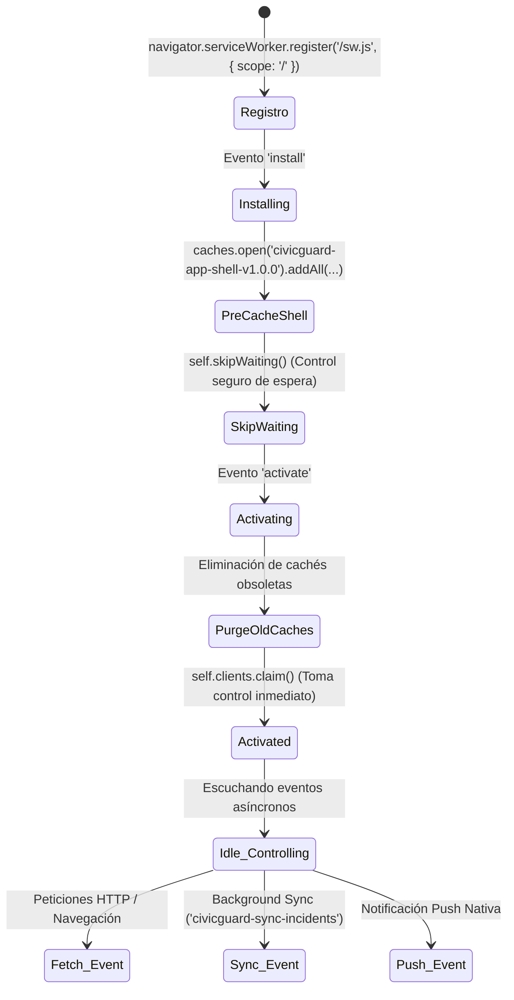

# Entregable Técnico (Semana 2): Mapeo del Ciclo de Vida del Service Worker, Renderizado Mixto y Recursos Visuales Adaptativos

**Proyecto:** Sistema de Gestión de Emergencias e Incidencias en Infraestructura Urbana *"CivicGuard PWA"*  
**Enfoque:** Unidad II (Renderizado, Obtención de datos y Programación de PWA).

---

## 1. Mapeo del Ciclo de Vida del Service Worker (`/sw.js`)

El script del Service Worker se encuentra en la raíz pública del proyecto (`frontend/public/sw.js` expuesto en `/sw.js`) para gobernar el **Ámbito Global (`scope: "/"`)** de la red.



### Escuchadores Asíncronos Obligatorios Implementados en `frontend/public/sw.js`

#### A. Fase de Instalación (`install`) y `self.skipWaiting()`
```javascript
self.addEventListener('install', (event) => {
  event.waitUntil(
    caches
      .open(SHELL_CACHE_NAME)
      .then((cache) => cache.addAll(APP_SHELL_ASSETS))
      .then(() => self.skipWaiting()) // Evita bloqueo en estado waiting
  );
});
```

#### B. Fase de Activación (`activate`) y `self.clients.claim()`
```javascript
self.addEventListener('activate', (event) => {
  event.waitUntil(
    caches
      .keys()
      .then((cacheNames) =>
        Promise.all(
          cacheNames.map((cacheName) => {
            if (cacheName !== SHELL_CACHE_NAME && cacheName !== DYNAMIC_CACHE_NAME) {
              return caches.delete(cacheName);
            }
            return Promise.resolve();
          })
        )
      )
      .then(() => self.clients.claim()) // Reclama clientes abiertos en el Scope "/"
  );
});
```

---

## 2. Configuración Automática de Splash-Screen, Home-Screen y Maskable Icons

En `frontend/public/manifest.json` se definieron las propiedades de lanzamiento nativo para Android, iOS y Desktop:
- **`display: "standalone"`**: Suprime la barra de direcciones del navegador para brindar experiencia nativa.
- **`background_color: "#0f172a"` y `theme_color: "#10b981"`**: Generan automáticamente la **Splash-screen nativa** del sistema operativo durante el arranque en frío.
- **Recursos Visuales Adaptativos (`Maskable Icons`)**:
  - `/icons/icon-192x192.png` (`purpose: "any"`) — Icono de Home-screen estándar.
  - `/icons/icon-512x512.png` (`purpose: "any"`) — Icono de alta densidad para Splash-screen.
  - `/icons/icon-maskable-512x512.png` (`purpose: "maskable"`) — Icono con zona segura (*safe zone* del 80% central) que se adapta a recortes circulares, *squircle* o lágrima en lanzadores Android modernos sin cortar el emblema de CivicGuard.

---

## 3. Modelo de Renderizado Mixto (Static App Shell Placeholders + CSR)

1. **Inyección Estática Estructural (`frontend/src/index.html`):**
   Dentro de `<app-root>` se inyecta el cascarón visual estático (`.app-shell-static-placeholder`) con la barra superior de CivicGuard y *skeletons* animados en CSS puro. Esto permite un **First Contentful Paint (FCP) < 0.3s** incluso en redes 3G degradadas o Modo Avión antes de descargar o ejecutar cualquier script de aplicación.
2. **Client-Side Rendering Reactivo (`frontend/src/app/app.component.ts`):**
   Una vez inicializado el motor de Angular, reemplaza los *placeholders* estáticos por los componentes interactivos conectados a `IndexedDB`, `Geolocation`, `MediaDevices` y la API REST de Laravel.
