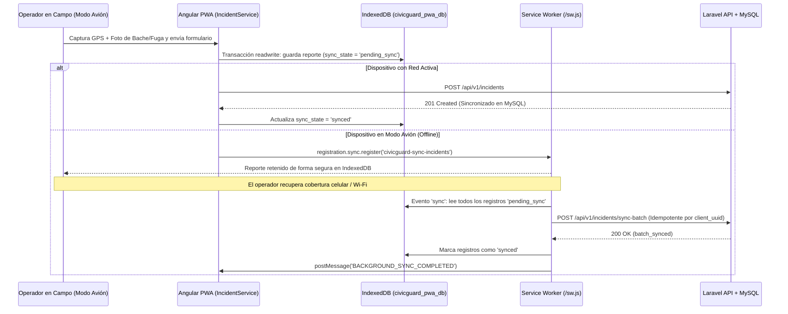

# Entregable Técnico (Semana 3): Módulo Operativo Offline, Persistencia Dual, Acceso a Hardware y Background Sync

**Proyecto:** Sistema de Gestión de Emergencias e Incidencias en Infraestructura Urbana *"CivicGuard PWA"*  
**Enfoque:** Unidad II (Obtención de datos y Programación de PWA).

---

## 1. Dualidad de Almacenamiento Local Asíncrono (Cero `localStorage`)

Cumpliendo estrictamente la restricción técnica que prohíbe APIs síncronas bloqueantes (`localStorage` / `sessionStorage`), CivicGuard PWA divide la persistencia en dos motores asíncronos no bloqueantes:

| Motor de Almacenamiento | Implementación en el Proyecto | Tipo de Datos Persistidos | Estrategia de Acceso |
| :--- | :--- | :--- | :--- |
| **Cache API** (`window.caches`) | `frontend/public/sw.js` (`civicguard-app-shell-v1.0.0` y `civicguard-dynamic-v1.0.0`) | HTML del Application Shell, hojas de estilo CSS, bundles JS compilados e íconos `maskable`. | **Cache-First** para arranque instantáneo en Modo Avión. |
| **IndexedDB** (`window.indexedDB`) | `frontend/src/app/core/services/indexed-db.service.ts` (`civicguard_pwa_db` → almacén `incidents`) | Objetos JSON estructurados de incidencias, coordenadas GPS (`latitude`, `longitude`, `accuracy_meters`), fotografías en Base64 JPEG (`photo_data`) y bandera `sync_state` (`pending_sync` \| `synced`). | Transacciones asíncronas `readwrite` y `readonly` indexadas por `client_uuid` y `by_sync_state`. |

---

## 2. Acceso Controlado a Hardware Físico del Dispositivo (`hardware.service.ts`)

### A. API de Geolocalización (`navigator.geolocation.getCurrentPosition`)
- Configurada con `enableHighAccuracy: true`, `timeout: 10000` y `maximumAge: 0` para forzar lectura fresca del chip GPS del teléfono.
- Captura latitud, longitud con precisión de 7 decimales y el margen de error en metros (`accuracy_meters`).

### B. API de Cámara (`navigator.mediaDevices.getUserMedia`)
- Solicita el flujo de video de la cámara trasera (`facingMode: { ideal: 'environment' }`).
- Procesa el fotograma en un elemento `<canvas>` HTML5 fuera de pantalla, estampa una marca de agua forense con fecha/hora local y genera un flujo comprimido JPEG (`0.78` quality) que se almacena directamente dentro de la transacción de **IndexedDB** para operar sin conexión.

---

## 3. Algoritmos de Red Resilientes y Background Sync API

---

## 4. Guía de Verificación en Modo Avión (Lista de Cotejo Semana 3)

1. Abrir la aplicación en `http://localhost:4200` (o URL HTTPS de `ngrok` en móvil).
2. Activar **Modo Avión** en el dispositivo (o pulsar el botón **"✈️ Simular Modo Avión"** en la barra de telemetría superior).
3. Presionar **"📍 Capturar GPS Actual"** y **"🎥 Abrir Cámara" → "📸 Capturar Fotografía Ahora"**.
4. Completar título y descripción y pulsar **"💾 Guardar en IndexedDB (Modo Avión)"**.
5. Verificar en la bitácora que la tarjeta aparece inmediatamente con la insignia amarilla **"⏳ Retenido en IndexedDB (Pendiente Sync)"** y con la foto renderizada desde disco local.
6. Desactivar el Modo Avión: la PWA detecta el evento `online` / `Background Sync`, envía el lote a `/api/v1/incidents/sync-batch` y actualiza la insignia a **"☁️ Sincronizado en MySQL"**.
